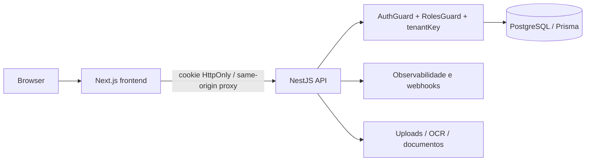

# Arquitetura de Segurança

## Escopo

Auditoria do snapshot local em 2026-10-19. O backend NestJS é a fronteira de autorização; o frontend Next.js é cliente e camada de experiência. O worker separado não está disponível como pacote verificável neste snapshot.

## Fluxo de confiança

Controles principais: sessão com cookie HttpOnly, autenticação no backend, autorização por papel e tenant, validação de uploads, sanitização de observabilidade, CORS por allowlist e headers de segurança no frontend.

## Limites

- PostgreSQL é a fonte de dados e deve receber migrações revisadas.
- Segredos locais ignorados não foram lidos nem expostos; produção deve usar secret manager.
- Backup, restauração, RLS, WAF, logs de produção e configuração efetiva de proxy permanecem não verificados.
