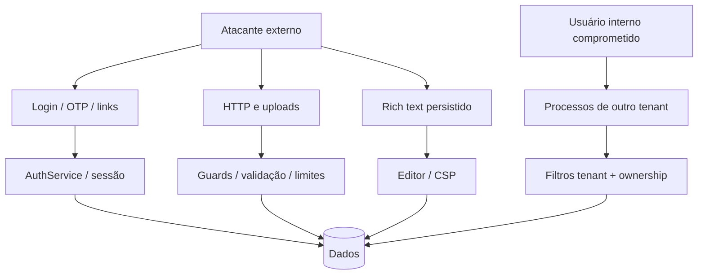

# Modelo de Ameaças

## Abusos considerados

- enumeração de login, OTP e links;
- replay ou vazamento de token em URL;
- XSS por conteúdo rico persistido;
- upload malicioso, DoS de memória/CPU e parsing DOCX/PDF;
- acesso horizontal entre tenants;
- abuso de observabilidade e webhooks;
- falsificação de IP atrás de proxy;
- exposição de serviços locais e credenciais padrão;
- dependências vulneráveis e supply chain.

## Mitigações e lacunas

Sessões, OTP, guards, filtros de tenant, validação de arquivos, CSP, CORS e headers têm controles implementados. Permanecem lacunas em RLS/FKs compostas, rate limiting distribuído, E2E HTTP real, worker ausente, backup/restore e configuração de produção.
